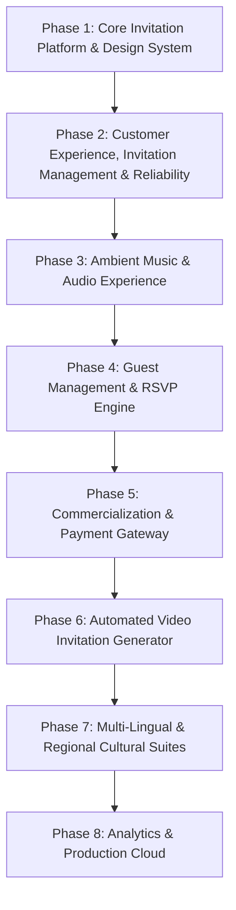

# ShaadiVibe — Platform Master Roadmap & Phase Architecture

Welcome to **ShaadiVibe**, the next-generation digital Indian wedding invitation and celebration management platform. ShaadiVibe blends centuries of rich Indian wedding tradition and royal aesthetics with state-of-the-art interactive web technology.

This document outlines the multi-phase engineering and product roadmap for the entire ShaadiVibe platform.

---

## Roadmap Overview

---

## Detailed Phases

### Phase 1: MVP Core Platform & Dynamic Invitation Experience (COMPLETED)
*Goal: Deliver a production-grade, highly aesthetic multi-page platform with full customization, dynamic envelope opening, interactive event timeline, and administrative control.*

- **Visual Identity & Design System**:
  - Deep Burgundy (`#5C061D`), Warm Ivory (`#FAF7F2`), Antique Gold (`#D4AF37`), Dark Brown Typography (`#2A1810`).
  - Ornate Indian wedding motifs, mandap arches, gold foil borders, floral accents.
  - Serif headings (`Cinzel` / `Cormorant Garamond`) and modern readable body typography.
- **Public Homepage (`/`)**:
  - Premium hero section with interactive 3D invitation mockups and dynamic CTAs.
  - Trust indicators, feature highlights, and trending themes with category filters.
  - "How It Works" 3-step guide and cultural value proposition.
  - Curated demo testimonials and interactive FAQ accordion.
- **Theme Gallery (`/themes`) & Theme Preview (`/themes/:slug`)**:
  - Filterable by aesthetic style: Royal, Traditional, Floral, Minimal, Modern, Destination, Regional.
  - Live interactive sample previews with feature breakdowns and responsive view modes.
- **Customization Wizard (`/customize/:themeId`)**:
  - Multi-step wizard without music step (Step 1: Wedding Details & Event Itinerary, Step 2: Photo Upload & Gallery, Step 3: Real-Time Preview & Draft Save).
  - Validation with Zod, multi-photo preview and management.
- **Dynamic Invitation Renderer (`/invite/:slug`)**:
  - 3D interactive envelope opening sequence with gold wax seal click.
  - Staggered bride & groom typography reveals.
  - 3 interactive decorative cards (Sacred Vows, Royal Dress Code, Venue & Accommodations).
  - Real-time countdown timer to the auspicious wedding hour.
  - Scroll-animated wedding event itinerary (Haldi, Mehendi, Sangeet, Baraat, Pheras, Reception).
  - Non-blocking ambient falling flower petals with `prefers-reduced-motion` accessibility support.
- **Backend Architecture & Admin Panel (`/admin`)**:
  - Express.js REST API with MongoDB/Mongoose (User, Theme, Invitation, SiteContent models).
  - JWT-secured Admin authentication.
  - Admin dashboard: theme management (create, edit, publish/unpublish) and homepage content CMS.
  - Local disk storage abstraction for wedding photos with mimetype and size checks.

---

### Phase 2: Customer Experience, Invitation Management & Reliability (COMPLETED)
*Goal: Empower customers to reliably create, save drafts to MongoDB, reopen & edit, publish invitations with stable unique URLs, and manage them via an authenticated customer dashboard.*

- **Customer Authentication & Ownership**:
  - Customer registration (`POST /api/auth/register`), login (`POST /api/auth/login`), logout (`POST /api/auth/logout`), session verification (`GET /api/auth/me`).
  - Bcrypt password hashing (minimum 8 characters), JWT validation, and secure HTTP-only cookies (`SameSite: Lax`, `Secure: production`).
  - Role separation: distinct `customer` and `admin` permissions with no privilege leakage.
- **Persistent Invitation Drafts & Lifecycle**:
  - Server-side MongoDB draft persistence with unique slug generation.
  - Reopening and editing existing drafts (`/customize/:themeId?edit=:id`).
  - Explicit publishing workflow (`PATCH /api/invitations/:id/publish`) and unpublishing (`PATCH /api/invitations/:id/unpublish`).
  - Strict privacy: unpublished drafts remain private to owner and admin (anonymous visitors receive 404).
  - IDOR defense: verified that customers cannot read, update, publish, or delete drafts belonging to other customers (403 Forbidden).
- **Customer Dashboard (`/dashboard`)**:
  - Overview of customer's invitations with Draft and Published filter tabs.
  - Dynamic ceremony count, wedding date, and last-updated information.
  - Actions: Continue Editing, Preview, Share / Copy Link, Unpublish, and native Delete Confirmation Modal (no browser `alert`/`confirm`).
- **Photo Management & Validation**:
  - Mimetype and extension allow-lists (`.jpg`, `.jpeg`, `.png`, `.webp`), 5MB size limit, path traversal sanitization with `path.basename()`.
  - Associating photos with customer invitations and ensuring reliable asset retrieval.
- **Test Suite & Monorepo Validation**:
  - 13 automated backend API tests (`server/tests/api.test.js`) using Node's native test runner.
  - 9 Vitest frontend schema and date tests.
  - Successful production bundle build (`client/dist/`).

---

### Phase 3: Ambient Music & Audio Experience
*Goal: Bring Indian wedding auditory richness into the digital invitation.*

- Curated library of traditional and modern Indian wedding instrumentals (Shehnai, Sitar, Flute, Santoor, Royal Dhol, Classical Ragas).
- Floating ambient audio player with custom gold-vinyl/flute animations, volume control, and play/pause state persistence.
- Customer audio upload: MP3/M4A validation with waveform trimming.
- Auto-play handling adhering to browser permissions with polite "Tap to Unmute" golden chime prompts.
- Audio synchronization with envelope opening fanfare.

---

### Phase 3: Guest Management & RSVP Engine
*Goal: Turn digital invitations into a two-way celebration management tool.*

- Guest list CSV/Excel upload and digital address book.
- Unique personalized guest URLs (`/invite/:slug?guest=rajesh-family`).
- Multi-tier RSVP collection:
  - Attendance confirmation (Attending, Regretfully Decline, Ceremony-specific attendance).
  - Guest count (Adults, Children).
  - Dietary preferences (Jain, Pure Vegetarian, Vegan, Traditional Feast).
  - Accommodation and shuttle requirements.
- Real-time host RSVP dashboard with export to Excel/PDF.
- One-click WhatsApp invitation generator with pre-filled personalized guest messages.

---

### Phase 4: Commercialization, Pricing & Checkout
*Goal: Monetize ShaadiVibe through transparent tier-based pricing and secure transactions.*

- Tiered pricing packages:
  - **Silver (Digital Basic)**: Single card invite, static agenda, standard countdown.
  - **Gold (Royal Interactive)**: 3D Envelope unwrap, interactive cards, full multi-day timeline, photo gallery.
  - **Kohinoor (Custom Luxury)**: Unlimited photos, custom domain (`priya-weds-rohan.shaadivibe.com`), priority support, extended hosting.
- Seamless payment gateway integration (Razorpay for India: UPI, NetBanking, Cards; Stripe for international NRI weddings).
- Discount coupons, referral codes, and festive seasonal promotions.
- Automated GST-compliant invoices and customer purchase receipts.

---

### Phase 5: Automated Video & Motion Invitation Generator
*Goal: Enable instant high-definition video invitation rendering for social media sharing.*

- Dynamic video rendering pipeline using Remotion / Server-side Canvas rendering.
- 9:16 vertical video format optimized for Instagram Stories and WhatsApp Status.
- 16:9 cinematic widescreen landscape video export.
- Dynamic text replacement with smooth transitions, motion graphics, and background music rendering.
- Direct download in 1080p Full HD MP4 format.

---

### Phase 6: Regional Cultural Suites & Multi-Lingual Localization
*Goal: Celebrate the diversity of Indian weddings across states and languages.*

- Specialized ceremony templates and cultural motifs:
  - **Punjabi & Sikh**: Anand Karaj, Chunni Ceremony, Jaago, Milni.
  - **South Indian (Tamil / Telugu / Kannada / Malayalam)**: Muhurtham, Mangala Snanam, Kanyadaanam, Saptapadi.
  - **Marwari & Rajasthani**: Pithi, Mayra, Band Bindayak, Ghoomar.
  - **Bengali**: Gaye Holud, Shubho Drishti, Saat Paake Ghaura, Sindoor Daan.
  - **Gujarati & Marathi**: Gol Dhana, Garba, Sakharpuda, Antarpat.
- Native multi-lingual script rendering in Devanagari (Hindi, Marathi), Gurmukhi (Punjabi), Tamil, Telugu, Gujarati, and Bengali.
- Culturally accurate calendar dates (Vikram Samvat, Saka, Hijri, Tamil Panchangam).

---

### Phase 7: Analytics, Notification Engine & Production Cloud Architecture
*Goal: Enterprise scalability, high availability, and intelligent event communications.*

- Cloud-native infrastructure on AWS / GCP with Docker containers and Kubernetes / Cloud Run.
- Cloud storage CDN with Cloudinary / AWS S3 for ultra-fast worldwide image delivery.
- WhatsApp Business API and Twilio SMS integration for automated ceremony reminders to confirmed guests.
- SendGrid transactional emails with branded RSVP summary digests for the hosts.
- Invitation analytics dashboard:
  - Real-time view counts, device breakdown (Mobile vs. Desktop), geographical visitor heatmaps.
  - RSVP conversion rates and peak view times.
- Multi-planner portal: Specialized agency accounts for professional wedding planners managing dozens of couples simultaneously.

---

*ShaadiVibe Architecture & Product Team — Document Version 1.0*
